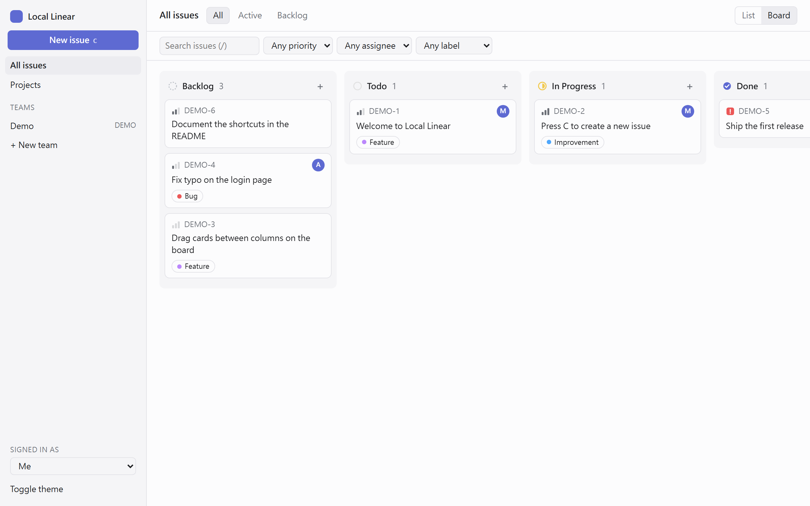
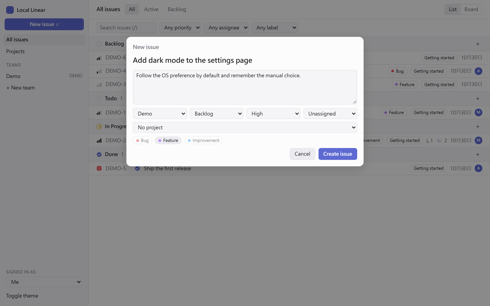
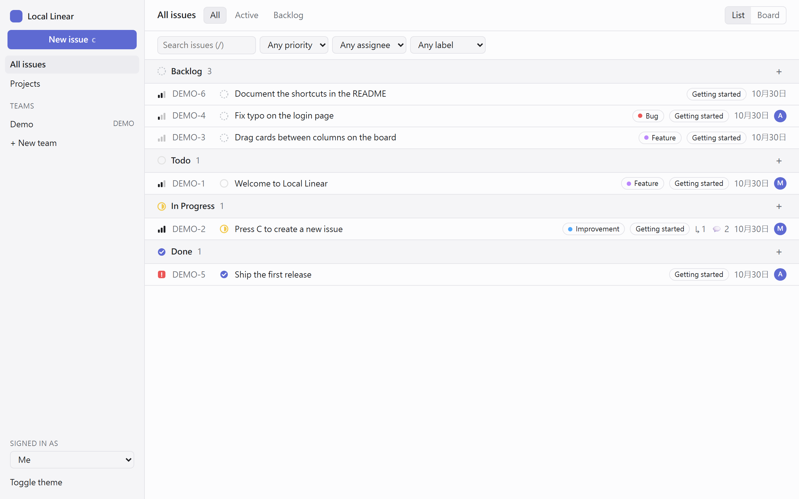
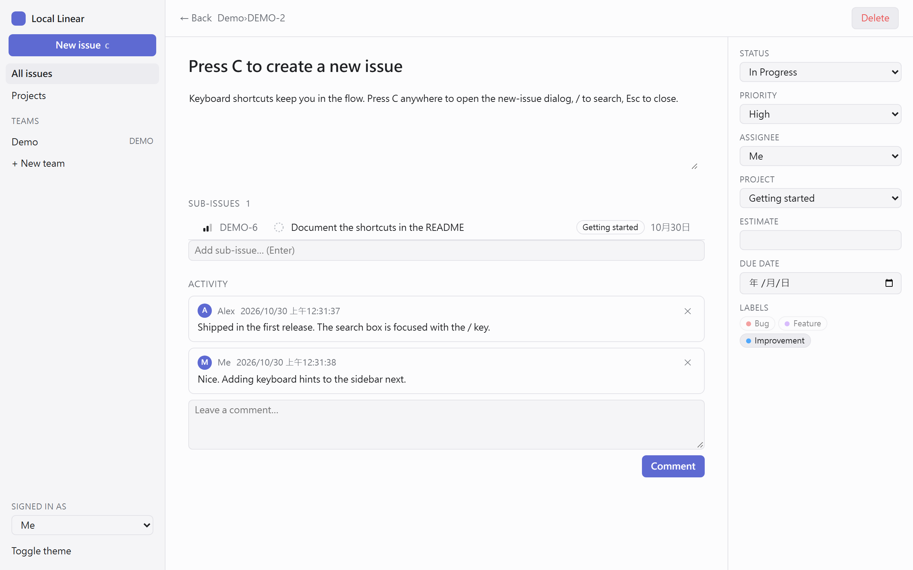
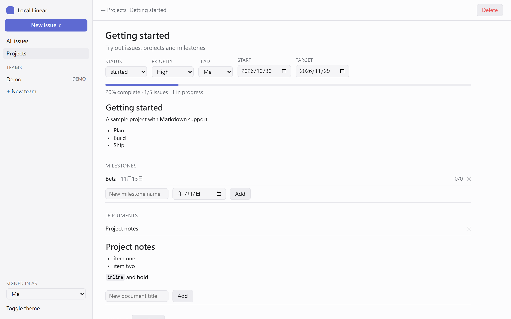

# Local Linear

[English](README.md) · **繁體中文**

在自己電腦上執行的 Linear 風格問題追蹤工具。用團隊、Issue(如 `ENG-12`)、工作流程狀態、優先度、標籤、
子 Issue、留言、含里程碑與文件的專案,以及 Cycle 來規劃工作,並提供列表和看板兩種檢視。
後端是 FastAPI、SQLAlchemy 與 SQLite,前端是不需要 build 的純 JavaScript。另外內建 [MCP](https://modelcontextprotocol.io)
server,讓 Claude 這類 AI 助理可以幫你建立專案和 Issue。



## 目錄

- [系統需求](#系統需求) · [快速開始](#快速開始)
- [使用說明](#使用說明)
- [設定](#設定)
- [REST API](#rest-api)
- [MCP server](#mcp-server)
- [開發](#開發) · [限制](#限制)

## 系統需求

- [uv](https://docs.astral.sh/uv/)(會自動幫你安裝適合的 Python;專案需要 Python 3.12 以上)
- 較新的瀏覽器

還沒有 uv 的話請先安裝:

```powershell
# Windows
powershell -ExecutionPolicy ByPass -c "irm https://astral.sh/uv/install.ps1 | iex"
```

```bash
# macOS / Linux
curl -LsSf https://astral.sh/uv/install.sh | sh
```

## 快速開始

```bash
git clone https://github.com/kuobrian/linear_notebook.git
cd linear_notebook
uv sync
uv run local-linear
```

打開 <http://127.0.0.1:8000>。第一次啟動會在目前目錄建立 `local_linear.db`,並放入一組示範資料
(團隊 `DEMO`、幾個 Issue、一個專案),讓你馬上可以操作。要換 port 用 `--port 9000`,開發時可加 `--reload`。
想從空白開始,用 `LOCAL_LINEAR_SEED=0` 啟動。

## 使用說明

### 先建立團隊,再建立 Issue

所有東西都屬於某個**團隊**,團隊代號(例如 `ENG`)會成為 Issue 編號的前綴,如 `ENG-1`。
在空的工作區按 **New issue**,會先要你建立團隊。每個新團隊都會有 Backlog、Todo、In Progress、Done、
Canceled 五個狀態。想再加團隊,按側邊欄的 **+ New team**;點某個團隊就只看它的 Issue。

在任何地方按 **C**(或按 **New issue**)開啟建立視窗。填標題,其餘的說明、狀態、優先度、負責人、專案、
標籤都是選填。按 **Ctrl+Enter** 送出。



### 列表與看板

預設是依狀態分組的列表。每一列顯示優先度、編號、狀態、標題、標籤、專案、子 Issue 與留言數、建立日期和負責人。



- 上方 **All / Active / Backlog** 分頁可縮小範圍(Active 指 Todo 和 In Progress)。
- 可依優先度、負責人、標籤篩選,也能搜尋標題和說明:在搜尋框輸入(按 **/** 可直接跳到搜尋框)後按 **Enter**。
- 切到 **Board** 會看到每個狀態一欄。**把卡片拖到另一欄就能改變狀態。** 欄位或群組上的 **+** 會在該狀態下建立 Issue。

### 處理一個 Issue

點 Issue 進入詳情頁。標題和說明在你點到別處時自動儲存。右側面板可設定狀態、優先度、負責人、專案、預估、到期日和標籤。
說明下方可以新增**子 Issue**(輸入標題後按 Enter)與**留言**。留言會以側邊欄 **Signed in as** 選的人作為作者。

Issue 與專案的說明、留言和文件都支援 **Markdown**:標題、粗體/斜體/~~刪除線~~、清單、`- [ ]` 任務清單、引用、
程式碼區塊、表格和連結(單純的網址也會變成連結)。說明和文件平常顯示渲染後的結果,點一下即可編輯 Markdown 原始碼,
點到別處自動儲存(按 **Esc** 取消)。留言有 **Preview** 預覽按鈕,**Ctrl+Enter** 送出。原始 HTML 不會被渲染,只會以文字顯示。



### 專案

**Projects** 以卡片列出所有專案,顯示狀態、負責人和進度條(已完成 Issue 佔所有未取消 Issue 的比例)。
點進專案可編輯狀態、優先度、負責人和起訖日期,寫說明、新增**里程碑**,並維護**文件**(點文件即可編輯,點到別處時自動儲存)。
專案內的 Issue 會列在頁面下方,也可以在 Issue 詳情頁把它指派到某個專案。



### 補充

- 側邊欄的 **Toggle theme** 可切換淺色和深色。
- 使用者和標籤目前沒有操作畫面,請透過 [REST API](#rest-api) 建立(示範資料已有使用者 *Me*、*Alex* 與三個標籤)。
  Cycle 目前同樣只有 API。
- 你的資料就是那一個 SQLite 檔案。複製它就是備份,刪掉它就是重來。

## 設定

| 環境變數 | 預設值 | 用途 |
| -- | -- | -- |
| `LOCAL_LINEAR_DB` | `sqlite:///local_linear.db` | SQLAlchemy 資料庫網址。預設路徑相對於你啟動程式的目錄。 |
| `LOCAL_LINEAR_SEED` | `1` | 設成 `0` 則在空資料庫上不建立示範資料。 |

## REST API

介面做的每件事都走 `/api` 底下的 JSON API。所有端點的互動式文件在 <http://127.0.0.1:8000/docs>。
以下範例(在全新資料庫上實際跑過):

```bash
BASE=http://127.0.0.1:8000
JSON='Content-Type: application/json'

# 建立團隊(會得到五個預設狀態,全新資料庫中 id 為 1-5)
curl -X POST $BASE/api/teams -H "$JSON" -d '{"key":"ENG","name":"Engineering"}'

# 建立 Issue,回應中會有編號(ENG-1)
curl -X POST $BASE/api/issues -H "$JSON" -d '{"team":"ENG","title":"Fix login bug","priority":2}'

# 移到 In Progress(狀態 id 可由 GET /api/teams 查到)
curl -X PATCH $BASE/api/issues/ENG-1 -H "$JSON" -d '{"status_id":3}'

# 留言
curl -X POST $BASE/api/issues/ENG-1/comments -H "$JSON" -d '{"body":"Reproduced on staging."}'

# 建立專案,再把 Issue 放進去
curl -X POST $BASE/api/projects -H "$JSON" -d '{"team":"ENG","name":"Auth revamp","status":"started","target_date":"2026-12-31"}'
curl -X PATCH $BASE/api/issues/ENG-1 -H "$JSON" -d '{"project_id":1}'

# 篩選與搜尋 Issue
curl "$BASE/api/issues?team=ENG&priority=2&q=login"

# 使用者與標籤(介面目前沒有對應畫面)
curl -X POST $BASE/api/users  -H "$JSON" -d '{"name":"Sam","email":"sam@example.com"}'
curl -X POST $BASE/api/labels -H "$JSON" -d '{"name":"Bug","color":"#eb5757"}'
```

說明:優先度 `0` 無、`1` 緊急、`2` 高、`3` 中、`4` 低。`PATCH` 時送 `null` 可清空欄位(例如 `{"assignee_id": null}`),
沒送的欄位維持不變。錯誤會以 4xx 狀態回傳 `{"detail": "..."}`。文字欄位存的是 Markdown 原始碼;詳情回應另外附上已渲染且安全的
`description_html` / `body_html` / `content_html`,也可以用 `POST /api/markdown`(`{"text": "..."}`)渲染任意文字。

## MCP server

`local-linear-mcp` 是一個 MCP server(stdio),讓 Claude 這類 MCP 客戶端管理網頁介面所看到的同一個工作區。
它建立的內容會立刻寫入資料庫,重新整理頁面即可在介面上看到。

| 工具 | 功能 |
| -- | -- |
| `list_teams` / `create_team` | 列出團隊與代號 / 建立團隊(`ENG`) |
| `create_project` | 建立專案:team、name、summary、description、status、priority、color、lead、起訖日期 |
| `list_projects` / `get_project` | 列出專案與進度 / 取得單一專案(含里程碑與文件) |
| `create_issue` / `list_issues` | 建立 Issue(回傳如 `ENG-12`) / 列出與搜尋 Issue |

註冊到 Claude Code(請用絕對路徑,並改成你 clone 的位置):

```bash
claude mcp add local-linear \
  -e LOCAL_LINEAR_DB=sqlite:////absolute/path/to/local_linear.db \
  -- uv run --project /absolute/path/to/linear_notebook local-linear-mcp
```

或寫在任何客戶端的 JSON 設定:

```json
{
  "mcpServers": {
    "local-linear": {
      "command": "uv",
      "args": ["run", "--project", "/absolute/path/to/linear_notebook", "local-linear-mcp"],
      "env": { "LOCAL_LINEAR_DB": "sqlite:////absolute/path/to/local_linear.db" }
    }
  }
}
```

### 透過 HTTP

預設是由客戶端自己用 stdio 啟動 server。若想讓它常駐、讓客戶端用網址連線,改用 streamable HTTP 傳輸:

```bash
uv run local-linear-mcp --transport http            # http://127.0.0.1:8765/mcp
uv run local-linear-mcp --transport http --port 9000 --path /mcp
```

啟動時要設定 `LOCAL_LINEAR_DB`(和網頁版一樣),再註冊網址:

```bash
claude mcp add --transport http local-linear http://127.0.0.1:8765/mcp
```

其他支援 streamable HTTP 的客戶端只要填同一個網址。預設只綁定 `127.0.0.1`。目前**沒有身分驗證**:
若用 `--host 0.0.0.0`(會印出警告),任何連得到該埠的人都能讀取和修改你的工作區,請只在可信任的網路使用。

接著就可以對助理說,例如:*「在 ENG 團隊建立一個叫 Billing revamp 的專案,狀態 started,目標日期 2026-12-31。」*

> **請讓 MCP 和網頁版使用同一個資料庫檔案。** 預設的資料庫路徑相對於工作目錄,而 MCP 客戶端啟動 server 的目錄
> 通常和你執行網頁版的目錄不同。請兩邊都用絕對路徑的 `LOCAL_LINEAR_DB`(`sqlite:///` 加絕對路徑;
> Windows 例如 `sqlite:///C:/Users/you/local_linear.db`),否則會各用各的資料庫。MCP server 不會建立示範資料,
> 所以全新資料庫要先呼叫 `create_team`。

## 開發

```bash
uv run pytest        # API、示範資料與 MCP 測試(記憶體內 SQLite)
```

| 路徑 | 內容 |
| -- | -- |
| `src/local_linear/models.py` | SQLAlchemy 資料模型 |
| `src/local_linear/api.py` | `/api` 底下的 REST 路由 |
| `src/local_linear/schemas.py` | Pydantic 請求/回應模型 |
| `src/local_linear/mcp_server.py` | MCP server(stdio) |
| `src/local_linear/seed.py` | 示範資料 |
| `src/local_linear/static/` | 單頁介面(hash 路由,不需 build) |
| `tests/` | 測試 |
| `docs/images/` | README 截圖 |

## 限制

- 單人使用,沒有登入或權限;「Signed in as」只決定留言的作者。
- Markdown 的任務清單勾選框是唯讀的,要改文字才能勾選;原始 HTML 只會以文字顯示。
- 沒有即時協作、通知和 Git 整合。
- 使用者、標籤和 Cycle 目前只能透過 API 管理。
